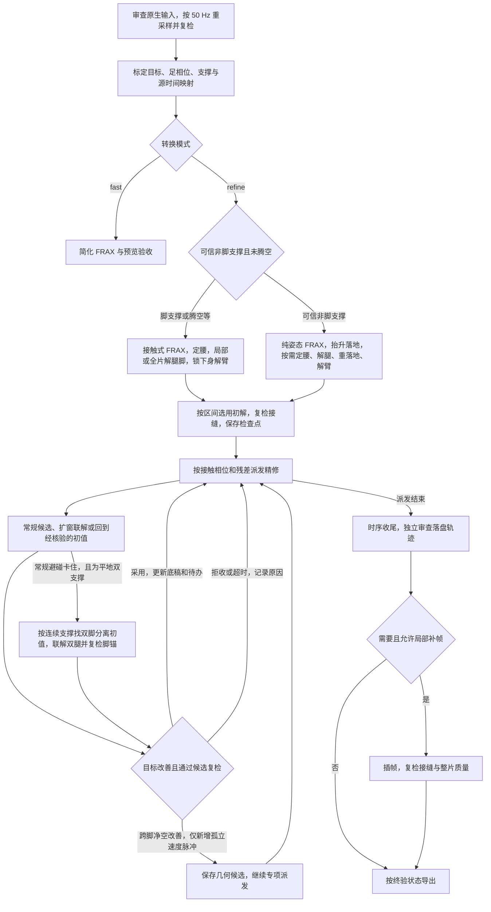
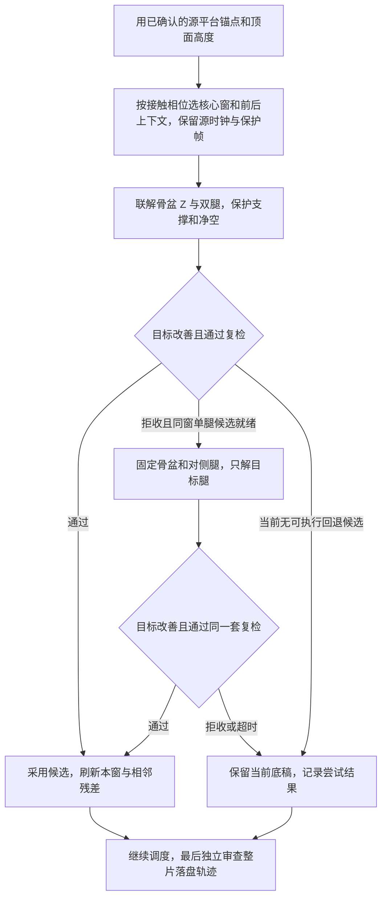

# 转换流程

[打开编号流程图](REFINE_FLOWCHART.html) · [平台相位联解试验](VALIDATION.md#平台相位联解试验)

## 输入和初解

BVH 和 SMPL-X 先进行完整原生输入审查，再检查重采样结果。即使指定 `--max-frames`，仍会检查整条原生输入。转换保留输出到源帧的时间映射。 [输入检查与帧号](INPUTS.md)

头部目标取人体头部相对躯干的朝向。两种模式都在机器人 yaw、pitch 硬限位内尽量跟踪。 [头部硬限位规则](SAFETY_REPAIR_RULES.md#头部硬限位)

`fast` 使用简化 Frax，供预览。`refine` 在接触标定后按支撑分流。

- **接触式初解。** 脚部站立、腾空，以及未确认非脚部支撑的帧使用接触式 Frax。保留接触式目标和 Fix 配置，先定腰，再按碰撞规模选局部腿脚或全片腿脚求解，锁下身后解双臂。腾空帧保留源脚部目标。
- **落地初解。** 可信膝胫、手或其他身体支撑且未腾空时，先使用 `pose_only` 和原始脚掌方向，再以连续接触段抬升回落。保留落地分支的 Fix 配置，按准备后的源位置锁定骨盆 XY，调整骨盆 Z 和关节。大范围碰撞触发定腰、联解下肢与骨盆 Z、复检接触、锁定下身再修双臂。解腿造成接触退化时，可对对应区间重落地，候选通过保护和净空复检才采用。
- **区间和接缝。** 落地标记向两端各扩约 0.25 秒，遇到腾空即停止。两类姿态按区间选用，检查相邻速度、根位置、自碰撞、穿地和接触滑移。接缝未通过时，在相位允许的范围内移动边界或尝试约束联解。`motion.full_chain.json` 记录分流证据、选用区间及接缝结果。

## 精修

默认路线 A 按接触相位和当前残差派发候选。重叠窗口先处理几何或可信支撑，独立窗口可以提前处理抖动。每类候选轮转，已采用的几何修复优先复查同窗口的抖动。 [转换命令与预算](../README.md#精修路线和预算)

单独出现的残差走常规专项。足腿碰撞与换脚过渡或接触残差相关时，按相位联解脚锚和净空。已经冻结的真实腾空段出现足腿碰撞时，允许在受控窗内重建双腿，固定骨盆、上身与两端接缝。原始 FRAX 检查点的帧数、帧率和根朝向相符时，也可作为相位回溯初值。联解和回溯候选都走同一套落盘复检。

有限预算下，前置抬升回落的派发时限是中段预算的十五分之一，上限 50 秒，只派给有可信身体支撑的源与机器人共同穿地窗口。专项根据终验影响、近期改善和候选实耗动态派发，为其他仍可推进的窗口保留尝试机会。短窗口优先约束实际超标的几何，必要时联解骨盆 Z 与腿部。可信身体支撑与足接触重叠时，联合恢复支撑和净空。末尾时序单独计时，可保护已踩稳的样本、修正摆动侧接缝，并在支撑期通过同侧关节补偿保住脚锚和足底高度。

重力与稳定高处足点判定成立的 LAFAN 区间自动使用平台支撑。高处支撑只有一侧时，避碰或落地候选可以限定为对侧腿，并保护骨盆和支撑侧。手臂末尾去抖只调整手臂且保护可信身体支撑。候选采用仍以整片几何和时序复检为准。

### A 路线的平台相位联解

初解后先拟合平台支撑。推断平台仍有脚锚或帧间净空残差时，默认 A 队列先试相位联解。若候选被拒收且同窗单腿候选就绪，下一步改试单腿，并固定骨盆和对侧腿。 [试验与接入复验](VALIDATION.md#平台相位联解试验)

平台候选保护两端接缝、实测平台支撑、骨盆 XY、根朝向、腰、双臂、头部和真实腾空帧。原帧复检平台脚锚，原帧和帧间均复检台面穿入。同时保护平地脚锚、可信身体支撑、滑移、自碰撞、净空、关节限位、速度和抖动。候选尝试及失败原因随检查点保留。

### 候选在报告中的名称

| 报告项 | 候选处理 |
|---|---|
| `ground_settle` | 对有支撑的落地窗口抬升回落，复检接触和净空。 |
| `support`、`dense_floor` | 联解骨盆 Z 与双腿，修正脚锚和帧间净空。 |
| `hip_roll_only`、`legs_preserve_support` | 先试局部髋轴，跨侧避碰或接触补偿需要时联解双腿与骨盆 Z。 |
| `phase_leg_clearance`、`phase_leg_rollback` | 在相位窗联解足腿避碰和接触，分别取当前轨迹或经核验的原始 FRAX 腿部初值。 |
| `cross_foot_contact_reconstruction` | 平地双支撑的常规避碰卡住时，从当前轨迹找双脚分离初值，联解双腿净空，复检脚锚及两端接缝。 |
| `platform_phase`、`platform_leg_only` | 修推断平台的脚锚和帧间净空，分别联解骨盆 Z 与双腿或只调整目标腿。 |
| `hand_leg_repair` | 手腿互撞时让手臂避开，必要时让相关腿轴协作。 |
| `pelvis_contact`、`surface_support_pose` | 在符合条件的路线和窗口内，共同处理多点支撑或承重手臂姿态。 |
| `torso`、`arms`、`leg_pose` | 按部位调整姿态，保留相应的支撑、保护帧和相邻速度约束。 |

按残差派发的 V8 连续段、边缘过渡和段内插件见[编号 58–66](REFINE_FLOWCHART.html#repair)。

## 限速和终验

`refine` 默认可通过局部补帧处理实际电机超速。补帧保留已有姿态，新增帧骨盆 XY 按时间线性插值。候选须通过速度、碰撞、净空、支撑和接缝复检才会采用。需要固定输出时间网格时可用 `--no-allow-local-slowdown`。`motion.json` 的 `retiming.final_adaptation` 记录采用与拒收原因。

若跨脚候选通过几何和支撑检查，且仅新增孤立速度脉冲，会按原网格暂存。末尾阶段在确认底稿仍相容后，可试插少量帧消除脉冲并重新独立验收。`retiming.contact_impulse_attempt` 记录未采用原因，补帧前的检查点保存在 `pre_final_retime`。

终验独立读取落盘轨迹。`motion.npz` 用于回放，`training.npz` 只在 `refine` 通过导出条件时生成。`repair.json` 记录专项尝试与结果。 [查看结果与排查](VALIDATION.md) · [候选采用与验收规则](SAFETY_REPAIR_RULES.md)
