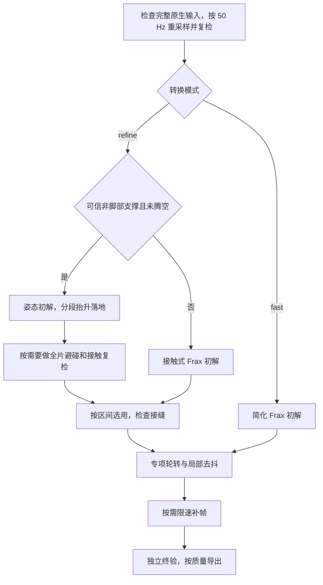

# 转换流程

[打开编号流程图](REFINE_FLOWCHART.html)

## 输入和初解

BVH 和 SMPL-X 先进行完整原生输入审查，再检查重采样结果。即使指定 `--max-frames`，仍会检查整条原生输入。转换保留输出到源帧的时间映射。 [输入检查与帧号](INPUTS.md)

`fast` 使用简化 Frax，供预览。`refine` 在接触标定后按支撑分流。

- **接触式初解。** 脚部站立、腾空，以及未确认非脚部支撑的帧使用接触式 Frax。
- **落地初解。** 可信膝胫、手或其他身体支撑且未腾空时，先拟合骨盆、骨段和脚掌方向，再以连续接触段抬升回落。锁定骨盆 XY，调整骨盆 Z 和关节，并对抬升回落区间保持连续。大范围碰撞触发定腰、联解下肢与骨盆 Z、复检接触、锁定下身再修双臂。解腿造成接触退化时，可对对应区间重落地，候选通过保护和净空复检才采用。
- **区间和接缝。** 落地标记向两端各扩约 0.25 秒，遇到腾空即停止。两类姿态按区间选用，检查相邻速度、根位置、自碰撞、穿地和接触滑移。接缝未通过时，在相位允许的范围内移动边界或尝试约束联解。`motion.full_chain.json` 记录分流证据、选用区间及接缝结果。

## 精修

默认路线 A 按腿部避碰、脚锚支撑、帧间净空、局部去抖、身体支撑和手臂避碰轮转。优先派发尝试次数少的专项，同次数按上述顺序处理。 [转换命令与预算](../README.md#精修路线和预算)

### 候选在报告中的名称

| 报告项 | 候选处理 |
|---|---|
| `ground_settle` | 对有支撑的落地窗口抬升回落，复检接触和净空。 |
| `support`、`dense_floor` | 联解骨盆 Z 与双腿，修正脚锚和帧间净空。 |
| `hip_roll_only`、`legs_preserve_support` | 先试局部髋轴，跨侧避碰或接触补偿需要时联解双腿与骨盆 Z。 |
| `hand_leg_repair` | 手腿互撞时让手臂避开，必要时让相关腿轴协作。 |
| `pelvis_contact`、`surface_support_pose` | 在符合条件的路线和窗口内，共同处理多点支撑或承重手臂姿态。 |
| `torso`、`arms`、`leg_pose` | 按部位调整姿态，保留相应的支撑、保护帧和相邻速度约束。 |

## 限速和终验

`refine` 默认可通过局部补帧处理实际电机超速。补帧保留已有姿态，新增帧骨盆 XY 按时间线性插值。候选须通过速度、碰撞、净空、支撑和接缝复检才会采用。需要固定输出时间网格时可用 `--no-allow-local-slowdown`。`motion.json` 的 `retiming.final_adaptation` 记录采用与拒收原因。

终验独立读取落盘轨迹。`motion.npz` 用于回放，`training.npz` 只在 `refine` 通过导出条件时生成。`repair.json` 记录专项尝试与结果。 [查看结果与排查](VALIDATION.md) · [候选采用与验收规则](SAFETY_REPAIR_RULES.md)
